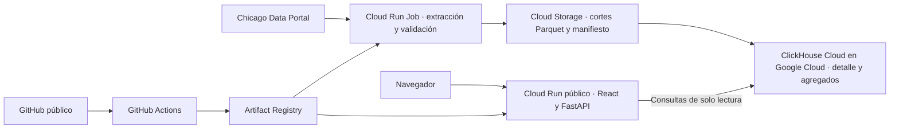

# Pulso Chicago

Plan de construcción y entrega para Inteligencia de Negocios · Actividad Individual II

## Qué vamos a construir

Un explorador público de viajes solicitados por aplicaciones en Chicago. La pregunta de negocio será **¿en qué zonas y franjas horarias convendría concentrar capacidad, a partir de la demanda histórica observada?** La demo partirá de una vista de toda la ciudad y permitirá seleccionar una zona para comparar semanas, identificar sus horas pico y ver sus destinos más frecuentes.

El trabajo técnico que distingue al proyecto será demostrar que las consultas sobre una tabla detalle y sobre datos preagregados dan el mismo resultado, y medir qué cambia en tiempo y volumen leído. La aplicación acompañará el panel con un apartado de metodología que muestre la cobertura, la fecha de extracción y los resultados reales del experimento.

## Decisión tecnológica

| Opción | Encaje en el proyecto |
| --- | --- |
| **ClickHouse + Google Cloud** | Ruta principal. Permite enseñar un motor OLAP cliente-servidor, tablas columnares, agregados materializados y diagnóstico de consultas. La base corre en ClickHouse Cloud sobre Google Cloud y el sitio en Cloud Run. |
| DuckDB + Google Cloud | Contingencia si ClickHouse Cloud resulta inviable por costo o facturación. Un archivo DuckDB de solo lectura incorporado en la imagen de Cloud Run permite conservar el panel, los filtros y el experimento sobre detalle frente a preagregados. El artículo explicaría esa arquitectura embebida y la actualización se haría al reconstruir la imagen. |
| Apache Pinot o Druid | Candidatos para un proyecto centrado en ingesta continua y consultas sobre eventos en tiempo real. Para un corte histórico, la carga por lotes y los agregados de ClickHouse cubren el objetivo con menos servicios propios que operar. |

[Regiones de ClickHouse Cloud](https://clickhouse.com/cloud) · [DuckDB y concurrencia](https://duckdb.org/docs/current/connect/concurrency) · [Apache Pinot](https://pinot.apache.org/) · [Apache Druid](https://druid.apache.org/)

**Stack propuesto.** React + TypeScript con ECharts para los gráficos y el mapa. FastAPI con el cliente de ClickHouse para las consultas. El contenedor de FastAPI sirve el frontend compilado y la API bajo la misma URL. Docker Compose reproduce el entorno local. GitHub Actions automatiza pruebas, empaquetado y despliegue. Cloud Run Jobs ejecuta la carga histórica con una identidad separada.

## Datos y modelo OLAP

Usaremos **Transportation Network Providers – Trips (2025–)**, conjunto oficial `6dvr-xwnh`, y los límites de las 77 áreas comunitarias `igwz-8jzy`. Para la demo, cargar del **1 al 30 de noviembre de 2025** en hora local de Chicago, empezando por siete días completos para integrar todas las capas. El 22 de noviembre de 2026 se verificó que la API devuelve los campos necesarios y contó **7.627.660 filas de origen** entre el 1 de noviembre de 2025 inclusive y el 1 de diciembre exclusivo. El número definitivo de viajes se obtendrá al validar y deduplicar el corte descargado. La fuente redondea horarios a 15 minutos, tarifas a USD 2.50 y propinas a USD 1.00. El panel identificará las zonas sin código, el redondeo y la cobertura del corte. [Fuente de viajes](https://data.cityofchicago.org/d/6dvr-xwnh) · [Ficha y limitaciones](https://catalog.data.gov/dataset/transportation-network-providers-trips-2025) · [Límites geográficos](https://data.cityofchicago.org/d/igwz-8jzy)

| Elemento | Diseño |
| --- | --- |
| Hechos `fact_trips` | Un registro válido por `trip_id`. Fecha y hora locales de inicio, origen, destino, duración, millas, tarifa y monto total reportado. Tabla `MergeTree`, partición por mes y orden por fecha, zona de origen, hora y `trip_id`. |
| Dimensiones | Fecha, día de semana y hora derivados del inicio reportado. Origen y destino comparten el catálogo de zonas. Mantener nulos de ubicación como «Sin zona reportada» y distinguirlos visualmente. Usar horas calendario de Chicago y documentar que la hora repetida en el cambio de horario queda en el mismo grupo local. |
| Agregados | `agg_zone_hour` por fecha, hora y origen para mapa, totales y calor horario. `agg_od_day` por fecha, origen y destino para los flujos. Vistas materializadas incrementales sobre el detalle y tablas `SummingMergeTree`. Crear vistas antes de cargar y usar `sum` y `GROUP BY` al leer para combinar partes pendientes de fusión. |
| Métricas | Viajes observados, costo total reportado medio, duración media y variación porcentual entre semanas completas de siete días. Guardar sumas y conteos de valores presentes para calcular promedios ponderados. Conservar importes en tipo decimal, tratar cero denominadores como «Sin base» y mostrar cobertura geográfica. |

El panel hará **roll-up** de día a semana, **drill-down** de ciudad a zona y de día a hora, y **slice/dice** con filtros de fechas, origen y franjas en las vistas que soporten esas dimensiones. El ranking origen–destino usará granularidad diaria y el rango de fechas seleccionado. La carga histórica representa demanda observada dentro de los viajes reportados. [Materialización incremental en ClickHouse](https://clickhouse.com/docs/concepts/features/materialized-views/incremental-materialized-view)

## Qué verá el evaluador

1. **Panorama de la ciudad.** Mapa por área de origen, contador de viajes, monto medio reportado y calendario de semanas comparables.
2. **Detalle de zona.** Al seleccionar un área, un mapa de calor de día y hora y una serie temporal se actualizan. Se muestra el nombre de la zona y un control visible para volver al total de la ciudad.
3. **Flujos entre zonas.** Seleccionar origen y rango de fechas muestra el ranking de destinos y su proporción sobre los viajes del origen. El denominador y la cobertura se explican en pantalla.
4. **Método y rendimiento.** Mostrar lote activo, fechas, total cargado, registros descartados y un cuadro con el benchmark versionado. Incluir estados de carga, errores y filtros sin resultados.

El recorrido de la demo será **seleccionar el área con más recogidas del corte, localizar su hora pico, comparar dos semanas completas y mostrar los destinos de esa zona**. Elegiremos el hallazgo al consultar los datos, con cifras y denominadores que puedan reproducirse.

## Automatización y despliegue

| Etapa | Automatización y evidencia |
| --- | --- |
| Arranque | Preparar GitHub público, cuentas, proyecto GCP y ClickHouse Cloud en una región de Google Cloud disponible para ambos servicios. Documentar el alta inicial y mantener en scripts la configuración repetible. Crear Artifact Registry, Cloud Run, Secret Manager e identidades de despliegue, carga y ejecución. |
| Pull request | GitHub Actions ejecuta lint, pruebas SQL y de API con fixture pequeña y ClickHouse local, y compila el frontend. Bloquear el merge si fallan. El workflow de PR público se ejecuta sin credenciales de producción. |
| Construcción y despliegue | En `main`, autenticar GitHub Actions mediante OIDC y Workload Identity Federation con impersonación de cuenta de servicio, limitado al repositorio y la rama autorizada. Publicar imagen con el SHA y desplegar por digest. Crear una revisión candidata sin tráfico, probarla y promoverla al superar la verificación. Si falla, mantener la revisión anterior o volver a ella si ya recibió tráfico. |
| Extracción | Ejecutar el Job por ventana diaria, con paginación determinista por fecha e ID, límites de solicitudes y reintentos con espera para errores recuperables. Guardar los lotes como Parquet en Cloud Storage y registrar fuente, columnas, fecha de extracción, cortes, hashes, conteos y calidad. Leer esos archivos para reproducir la carga o ejecutar las pruebas de rendimiento. |
| Carga y publicación | Cargar primero en staging, validar y deduplicar antes de insertar en la tabla de hechos que dispara las vistas. Usar un esquema candidato por intento. Ante un fallo parcial, iniciar otro candidato desde los Parquet en vez de repetir la inserción sobre el candidato fallido. Publicar el nuevo lote en una revisión del sitio junto con su identificador, después de conciliar detalle y agregados. Conservar el corte anterior para poder volver a él. |
| Operación | La app usa un usuario SQL de solo lectura y el Job usa credenciales que le permiten cargar. Usar TLS, Secret Manager, consultas parametrizadas, topes de fechas y filas y tiempos máximos de consulta. Verificar la conexión de app y Job a ClickHouse desde el primer día. Si se requiere restringir por IP, usar salida estática en GCP y presupuestar Cloud NAT. Publicar la app por HTTPS junto con el enlace a la ejecución de Actions. |

[Despliegue con GitHub Actions](https://github.com/google-github-actions/deploy-cloudrun) · [Identidad federada en CI/CD](https://docs.cloud.google.com/iam/docs/workload-identity-federation-with-deployment-pipelines) · [Cloud Run público](https://docs.cloud.google.com/run/docs/authenticating/public) · [Orden de paginación en Socrata](https://dev.socrata.com/docs/queries/order) · [Salida IP fija en Cloud Run](https://docs.cloud.google.com/run/docs/configuring/static-outbound-ip) · [Filtros IP de ClickHouse Cloud](https://clickhouse.com/docs/products/cloud/guides/security/connectivity/setting-ip-filters)

**Control de costo.** Día 1, validar cuenta, facturación, región y vigencia del crédito de ClickHouse, y estimar el costo de conservar la demo hasta la evaluación. Configurar mínimos en cero y un máximo inicial de dos instancias del servicio web; limitar paralelismo del Job, plazo de retención y tamaño del corte. Considerar cómputo, almacenamiento, Artifact Registry, transferencia y NAT si aplica. Si la ruta principal resulta inviable en esa revisión, activar la ruta DuckDB antes de cerrar la semana de trabajo. [Precios de ClickHouse](https://clickhouse.com/pricing) · [Precios de Cloud Run](https://cloud.google.com/run/pricing) · [Controles de costo de Cloud Run](https://docs.cloud.google.com/run/docs/tips/services-cost-optimization)

**Contingencia de extracción.** Medir el tiempo y tamaño de un día completo antes de lanzar todo noviembre. Guardar cada ventana validada para retomarla sin descargarla de nuevo. Si el tiempo o los límites de la API ponen en riesgo el plazo, publicar dos semanas completas consecutivas, declarar el recorte en el panel y correr el benchmark sobre ese mismo corte. [Límites de resultados de Socrata](https://dev.socrata.com/docs/queries/limit)

## Pruebas y experimento

| Prueba | Evidencia para considerar terminada la fase |
| --- | --- |
| Calidad e idempotencia | Conteos por día, filas aceptadas y rechazadas, `trip_id` único, zonas válidas o sin reportar, comprobación de importes y duraciones fuera de rango. Al reprocesar los mismos Parquet, los resultados de negocio se mantienen. Incluir un caso de carga interrumpida y recuperación. |
| Exactitud OLAP | Comparar conteos, sumas y promedios ponderados entre detalle y agregados en un día, una semana, el mes y una zona. Validar nulos, semanas incompletas y rangos vacíos. |
| Rendimiento | Ejecutar tres consultas equivalentes en detalle y agregados, con igual rango, filtros y capacidad de cómputo. Usar 3 calentamientos por variante y 30 ejecuciones medidas alternadas, con caché de resultados desactivada. Capturar p50/p95 de duración del motor y filas/bytes leídos por `query_id`. Documentar versión, configuración, localidad y total del lote. Probar arranque en frío del sitio por separado. |
| Experiencia pública | Navegar sin sesión, pasar de ciudad a zona, modificar fechas y revisar resultados en escritorio y móvil. Registrar el SHA, URL y ejecución de Actions. Usar la revisión anterior para comprobar el procedimiento de reversión en una prueba controlada. |

**Meta interna inicial.** En la consulta de demanda de un mes, aspirar a reducir al menos 5× las filas leídas y a servir la consulta principal de la API con p95 inferior a 1 segundo en caliente, bajo una carga moderada definida y registrada. En el artículo y el video se publicarán los valores medidos aunque queden por debajo de la meta. El resultado central será la comparación reproducible. [Registro de consultas de ClickHouse](https://clickhouse.com/docs/reference/system-tables/query_log)

## Cronograma propuesto

Ocho días de trabajo desde el arranque. Adaptar los responsables a la cantidad real de integrantes.

| Día | Trabajo | Evidencia al cierre |
| --- | --- | --- |
| 1 | Confirmar integrantes, fecha, presupuesto y dueño del despliegue. Probar API de Chicago y publicar un contenedor mínimo en Cloud Run. | Muestra válida, URL inicial y decisión de plataforma. |
| 2 | Levantar Docker Compose, preparar fixture, modelos SQL y primera extracción. Diseñar el recorrido del dashboard. | Tablas locales y consultas sobre una muestra pequeña. |
| 3 | Cargar siete días, conectar FastAPI y React y activar CI de pull requests. | Primera vista navegable con datos reales y pruebas verdes. |
| 4 | Completar mapa, comparación semanal y ranking de destinos. Cargar noviembre con validación por día. | Recorrido completo y corte documentado. |
| 5 | Terminar CD, publicar la app y ejecutar una carga repetida. | Job trazable, revisión pública y pruebas de recuperación. |
| 6 | Correr el benchmark, revisar usabilidad y cerrar hallazgos. | Reporte reproducible, números confirmados y capturas. |
| 7 | Cada integrante revisa y publica su artículo. Grabar y publicar el video. | URLs públicas y duración verificada. |
| 8 | Revisar todos los enlaces en incógnito, enviar artículos y video al grupo de Telegram, y subir el ZIP a la tarea. | Mensaje enviado, ZIP revisado y constancia de entrega. |

Reparto inicial por frentes: **datos y calidad**, **modelado OLAP y benchmark**, **producto y visualización**, **automatización y nube**. Con menos integrantes se combinan frentes. Con más, se reparten calidad, diseño de API o reproducibilidad. Cada autor documenta una contribución que pueda mostrar con código, una prueba o una decisión técnica.

## Repositorio y artículos

El repositorio público tendrá `frontend/`, `api/`, `ingest/`, `sql/`, `tests/`, `benchmark/`, `infra/` y `.github/workflows/`. El README incluirá demo, arquitectura, preparación local con fixture, carga de datos reales, definición de métricas, ejecución del benchmark, automatización, créditos de datos y enlaces a los artículos y al video. Etiquetar una versión de entrega y usar sus permalinks en los artículos. Adjuntar el manifiesto y los resultados del benchmark sin credenciales ni archivos masivos de viajes.

Cada integrante publicará **un artículo propio en DEV Community**. Todos explicarán el proyecto completo en un párrafo, después entrarán a una parte distinta. Cada texto debe incluir al menos un ejemplo reproducible, una evidencia del trabajo, un resultado o limitación y enlaces a la demo y al repositorio.

| Frente | Título de trabajo |
| --- | --- |
| Datos | Cómo convertí viajes abiertos de Chicago en un lote reproducible para OLAP |
| Motor OLAP | Consultar millones de viajes con ClickHouse y medir el efecto de preagregar |
| Producto | Construir un explorador OLAP con mapa, hora pico y flujos entre zonas |
| Despliegue | Publicar una app OLAP en Google Cloud con GitHub Actions |
| Calidad, si hay un autor adicional | Cómo verifiqué que el detalle y los agregados de ClickHouse coinciden |

Si el título menciona «millones», confirmar el volumen en el manifiesto antes de publicar. Revisar la publicación con la URL pública desde una ventana privada. [Guía de publicación de DEV](https://dev.to/help/writing-editing-scheduling)

## Video público de 4 minutos y 40 segundos

| Tiempo | Qué mostrar |
| --- | --- |
| 0:00–0:25 | Pregunta de negocio y resultado inicial en la demo pública. |
| 0:25–1:05 | Fuente municipal, arquitectura y grano del hecho. |
| 1:05–2:20 | Recorrido real desde ciudad hasta zona y hora pico. Comparar semanas y mostrar destinos. |
| 2:20–3:25 | Ejecutar o mostrar dos consultas equivalentes y presentar las cifras del benchmark con unidades. |
| 3:25–4:15 | Mostrar GitHub Actions en verde, el Job de carga y la revisión desplegada. |
| 4:15–4:40 | Cerrar con un hallazgo observado, sus límites y los enlaces. |

Publicar en YouTube con visibilidad **Público**. Añadir subtítulos revisados y enlaces en la descripción. La consigna pide un video en singular; el plan asume **un video grupal**, con participación visible o acreditada de todos. Confirmar en el arranque si el docente espera un video por integrante. [Visibilidad de YouTube](https://support.google.com/youtube/answer/157177?hl=es)

## Telegram y entrega

1. Completar `ENLACES.md` usando la plantilla adjunta. Incluir los nombres y URLs de todos los artículos, el video público, el repositorio y la aplicación. Añadir el enlace a la ejecución de despliegue como evidencia.
2. Abrir cada URL en incógnito y revisar que funcione sin depender de la cuenta del equipo. Verificar autores, duración y visibilidad del video y que la demo cargue datos. Confirmar que la app siga disponible durante la corrección.
3. Publicar en el grupo de Telegram un mensaje con todos los artículos y el video. Adjuntar enlaces de código y demo en el mismo mensaje si ayudan a revisar la construcción.
4. Crear `Actividad-Individual-II-OLAP.zip` con `ENLACES.md` en la raíz. Abrir el ZIP para comprobar el contenido y subirlo a la tarea. Verificar que la plataforma muestre el archivo adjunto y la entrega registrada.
